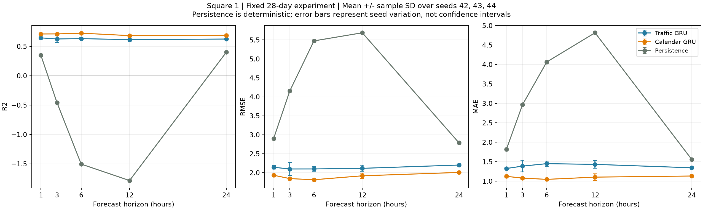

# Milano 통신 트래픽 예측: 시간 정보가 GRU 성능에 미치는 영향

2013년 11월 1~28일 Milano Square 1의 Internet activity를 10분 단위로 집계하고, 트래픽만 입력한 GRU와 시간 정보를 추가한 GRU를 비교했습니다. 원 논문의 전체 재현이 아닌 고정 조건 개선 아이디어 검증입니다.

- [발표 PPT 다운로드](deliverables/Milano_Traffic_Portfolio.pptx)
- [전체 실험 보고서](outputs/research_nov01_28/REPORT.md)
- [seed별 지표](outputs/research_nov01_28/metrics.csv) · [평균 및 표준편차](outputs/research_nov01_28/performance_formatted.csv)

## 핵심 결과

|예측 시점|기본 GRU RMSE|시간 정보 GRU RMSE|평균 RMSE 감소율|
|---|---:|---:|---:|
|1시간 후|2.1433|1.9333|9.80%|
|3시간 후|2.0982|1.8447|12.08%|
|6시간 후|2.0988|1.8146|13.54%|
|12시간 후|2.1155|1.9184|9.32%|
|24시간 후|2.2020|2.0071|8.85%|

seed 42/43/44 평균입니다. 감소율은 두 모델의 평균 RMSE를 기준으로 계산했습니다. 동일 horizon의 동일 test 시점에서 비교했으며, 좋은 결과를 얻기 위한 Square·기간 변경은 하지 않았습니다.



## 실험 조건

4032개 시점, 과거 24시간 입력, 1/3/6/12/24시간 후 단일 시점 direct forecasting. 시간순 70/15/15 분할 및 train 기준 표준화, validation 기반 early stopping을 적용했습니다. 개선 모델에는 시간대·요일 sin/cos와 주말 여부를 추가했습니다. Persistence도 동일 test 시점에서 평가했습니다.

## 재현

Python 환경을 만든 뒤 프로젝트 루트에서 실행합니다. 기존 결과를 보존하도록 새 출력 폴더를 사용합니다.

```shell
python -m pip install -r requirements-lock.txt
python -m unittest discover -s tests
python -m milano.experiment --series outputs/nov01_28/series.csv --config configs/experiment.json --out outputs/rerun
```

원본 데이터는 저장소에 포함하지 않습니다. [Harvard Dataverse 데이터셋](https://doi.org/10.7910/DVN/EGZHFV)에서 해당 28개 파일을 내려받아 raw 폴더에 넣은 뒤 아래와 같이 집계할 수 있습니다. raw 폴더에는 해당 기간 파일만 두세요.

```shell
python -m milano.preprocess --input "raw/sms-call-internet-mi-2013-11-*.txt" --square 1 --out outputs/rerun_data
```

원본 출처와 정의: [A multi-source dataset of urban life in the city of Milan and the Province of Trentino](https://www.nature.com/articles/sdata201555). Internet activity는 MB나 Mbps가 아닙니다. 원본의 이용조건은 데이터 제공처를 확인하세요.

## 한계와 구현 범위

단일 Square·28일·한 번의 시간순 분할 결과로 일반화는 검증하지 못했습니다. 3개 seed 표준편차는 초기화 변동이며 신뢰구간이 아닙니다. 겹치는 입력 창과 짧은 test 기간, 모델 입력 차원에 따른 파라미터 수 차이가 있습니다. 이미 관측한 test 값을 후속 입력에 사용하는 rolling-origin 평가입니다.

Python·PyTorch 기반 전처리, 학습, 검증, 보고서 작성에 AI 보조를 활용했습니다. 코드 변경 기록은 [EXPERIMENT_CHANGES.md](EXPERIMENT_CHANGES.md)에 보존했습니다. 공개용 복사본에서는 로컬 경로만 정리했으며 기존 지표·예측값·모델은 그대로 보존했습니다.
