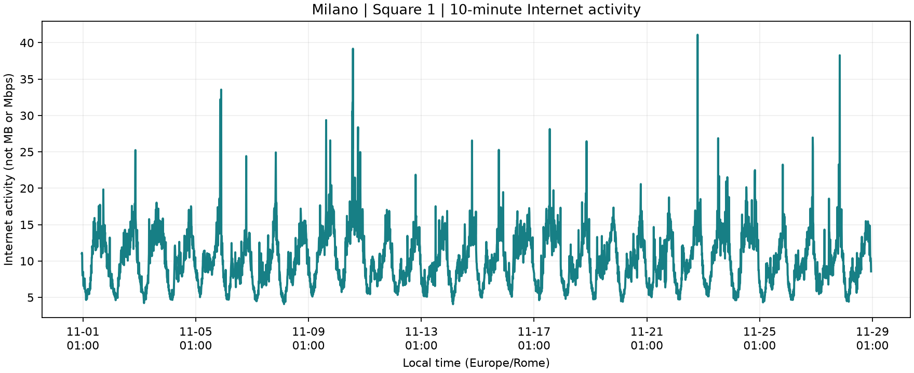
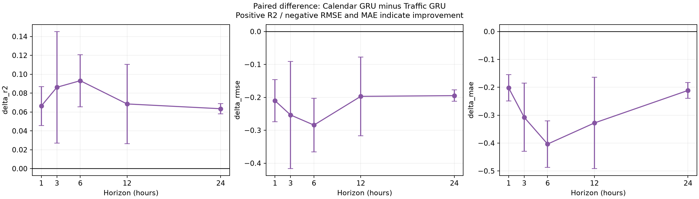
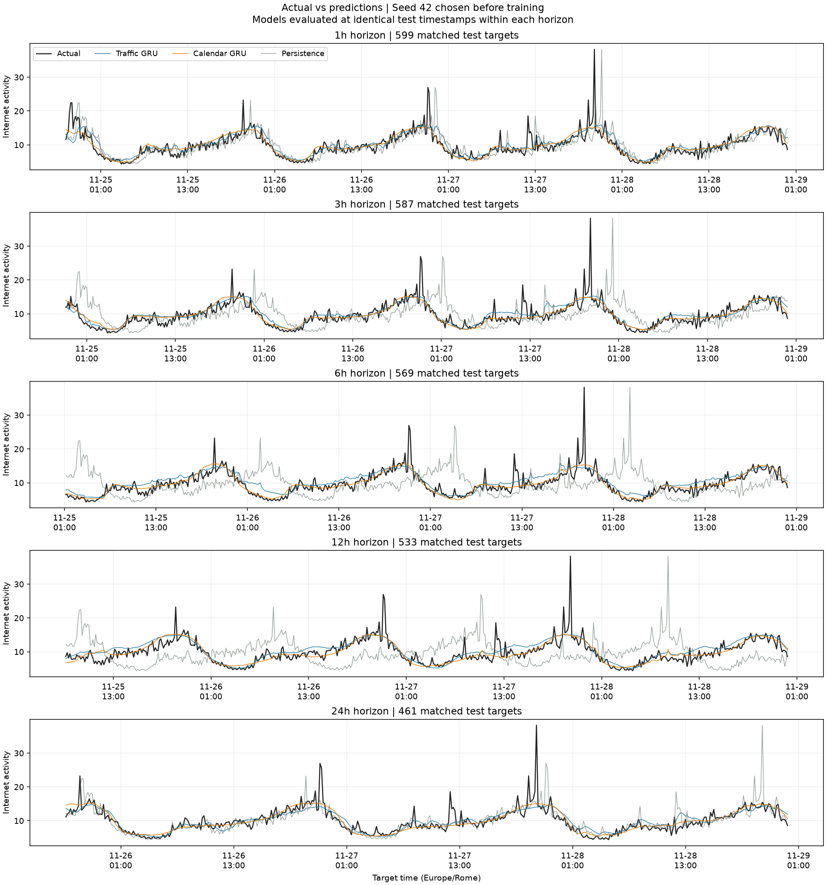

# Milano Square 1: 28일 고정 조건 본실험

본 보고서는 2013-11-01~2013-11-28, Square ID 1 및 사전 설정을 고정한 한 차례의 본실험 결과다. 테스트 결과를 보고 Square·기간·설정·seed를 변경하지 않았다.

## ① 데이터 검증 결과

- 날짜별 28개 원본 모두 존재. 날짜 누락, 파일 중복, 동일 내용 파일 중복 없음. 총 9,688,614,430바이트. 28개 모두 공식 MD5와 일치.
- 전체 149,959,224행에서 탭 구분 8열, ID·숫자 형식, 음수/비유한 관측값, 파일 날짜 범위 및 10분 정렬 검사 통과.
- Square 1의 국가 코드별 10,990행을 시각별 합산. 해당 Square의 `(timestamp, country_code)` 중복 키 0개. 다른 Square의 중복 키 전체 검사는 수행하지 않음.
- 현지 기간: **2013-11-01 00:00:00+01:00 ~ 2013-11-28 23:50:00+01:00**. Europe/Rome 기준 28일 × 144 = **4,032개**. 모든 간격은 10분.
- 없는 시간 구간 0개, 집계 후 결측 0개, 0 값 0개. 보간·대체·이상치 삭제를 하지 않음.
- 국가별 Internet 칸이 빈 행은 5,332개. 합산할 때 비어 있지 않은 값만 사용하고 전체가 빈 구간은 NaN으로 남기는 기존 규칙을 유지.
- 전체 시계열 평균 10.2609, 표본 표준편차 3.6959, 최솟값 4.0681, 최댓값 41.0967. IQR 기준 큰 값/작은 값 표식 40개는 오류로 단정하지 않고 모두 유지.
- Internet activity는 통신활동 지표이며 MB/Mbps가 아니다.

## ② 실험 조건

- 입력: 과거 24시간(144개 10분 값). 기본 GRU는 Internet 1개 특징, 개선 GRU는 Internet + 시간대 sin/cos + 요일 sin/cos + 주말 여부의 6개 특징.
- 예측: 마지막으로 관측한 구간의 시작 시각 t에서 t+1/3/6/12/24시간에 시작하는 10분 구간 값 한 개. 마지막 입력 구간이 완료되어 값이 이용 가능하다는 가정. 향후 구간 합계나 평균 예측이 아님.
- Horizon마다 별도 direct GRU. 5 horizons × 2 GRU × 3 seeds = 30회 학습.
- 시간순 train/validation/test 행 수: 2822/605/605 (70/15/15%를 정수로 절삭).
- 현지 validation 시작: 2013-11-20 14:20:00+01:00; test 시작: 2013-11-24 19:10:00+01:00.
- train 관측값만으로 정규화: 평균 10.26206440, 모집단 표준편차 3.66256871. 예측을 원래 활동 단위로 복원한 뒤 평가.
- 경계를 가로지르는 예측 표본 제외. validation/test의 예측 출발 시점도 해당 구간 안에 있어야 함. 입력에는 그 시점에 이미 관측한 이전 구간 값을 허용.
- 시험 중에도 과거 관측값을 다음 입력에 사용하는 rolling-origin 평가. 시험 기간 전체를 한 시점에서 예측하는 실험이 아님.
- GRU 1층, hidden size 32, linear 출력, Adam lr=0.001, batch size 64, MSE, gradient clipping 1.0, 최대 100 epochs, validation patience 10. 최소 validation MSE checkpoint 사용.
- seeds 42/43/44, CPU 단일 스레드·deterministic 실행. 두 모델의 설정은 같으나 입력 차원에 따라 파라미터 수는 기본 3,393개, 개선 3,873개로 다름.
- train 미니배치만 섞고 데이터 분할은 시간순으로 유지. test로 튜닝·조기종료·seed 선택을 하지 않음.
- Persistence: 해당 예측 출발 시점의 마지막 관측값을 그대로 예측. 각 horizon에서 모든 모델/seed의 시험 정답 시점 일치를 저장된 예측 CSV로 검증.

|Horizon|Train 표본|Validation 표본|Test 표본|
|---:|---:|---:|---:|
|1h|2673|599|599|
|3h|2661|587|587|
|6h|2643|569|569|
|12h|2607|533|533|
|24h|2535|461|461|

## ③ 최종 성능표

GRU는 seed 3개의 **평균 ± 표본 표준편차(ddof=1)**. Persistence는 결정론적 단일 결과라 ±를 붙이지 않았다. 표준편차는 seed 변동이며 신뢰구간이 아니다. R²는 클수록, RMSE/MAE는 작을수록 좋다.

|Horizon|모델|R²|RMSE|MAE|
|---:|---|---:|---:|---:|
|1h|기본 GRU|0.6447 ± 0.0159|2.1433 ± 0.0481|1.3261 ± 0.0313|
|1h|개선 GRU|0.7110 ± 0.0065|1.9333 ± 0.0218|1.1242 ± 0.0287|
|1h|Persistence|0.3489|2.9018|1.8204|
|3h|기본 GRU|0.6261 ± 0.0613|2.0982 ± 0.1700|1.3872 ± 0.1457|
|3h|개선 GRU|0.7122 ± 0.0026|1.8447 ± 0.0085|1.0796 ± 0.0280|
|3h|Persistence|-0.4594|4.1542|2.9658|
|6h|기본 GRU|0.6318 ± 0.0222|2.0988 ± 0.0637|1.4505 ± 0.0662|
|6h|개선 GRU|0.7249 ± 0.0064|1.8146 ± 0.0211|1.0469 ± 0.0184|
|6h|Persistence|-1.5042|5.4750|4.0631|
|12h|기본 GRU|0.6146 ± 0.0297|2.1155 ± 0.0815|1.4322 ± 0.1002|
|12h|개선 GRU|0.6831 ± 0.0230|1.9184 ± 0.0690|1.1042 ± 0.0877|
|12h|Persistence|-1.7841|5.6885|4.8144|
|24h|기본 GRU|0.6249 ± 0.0012|2.2020 ± 0.0035|1.3444 ± 0.0085|
|24h|개선 GRU|0.6883 ± 0.0059|2.0071 ± 0.0191|1.1330 ± 0.0193|
|24h|Persistence|0.3994|2.7862|1.5574|

## ④ 기본 GRU 대비 개선 GRU의 변화

Δ는 같은 seed의 **개선−기본** 차이의 평균 ± 표본 표준편차다. ΔR²가 양수이거나 ΔRMSE/ΔMAE가 음수이면 개선이다. 감소율은 `(기본 평균−개선 평균)/기본 평균×100`이며 음수이면 오차 증가다.

|Horizon|ΔR²|ΔRMSE|ΔMAE|평균 RMSE 감소율|평균 MAE 감소율|
|---:|---:|---:|---:|---:|---:|
|1h|+0.0663 ± 0.0206|-0.2100 ± 0.0640|-0.2019 ± 0.0470|+9.80%|+15.22%|
|3h|+0.0862 ± 0.0591|-0.2536 ± 0.1629|-0.3077 ± 0.1223|+12.08%|+22.18%|
|6h|+0.0931 ± 0.0276|-0.2843 ± 0.0815|-0.4036 ± 0.0834|+13.54%|+27.83%|
|12h|+0.0685 ± 0.0419|-0.1971 ± 0.1194|-0.3280 ± 0.1636|+9.32%|+22.90%|
|24h|+0.0634 ± 0.0053|-0.1949 ± 0.0172|-0.2114 ± 0.0279|+8.85%|+15.72%|

## ⑤ Persistence와 비교

아래는 Persistence 대비 각 GRU의 평균 오차 감소율이다. 양수는 GRU가 더 낮은 오차, 음수는 Persistence가 더 낮은 오차임을 뜻한다.

|Horizon|기본 GRU RMSE 감소율|개선 GRU RMSE 감소율|기본 GRU MAE 감소율|개선 GRU MAE 감소율|
|---:|---:|---:|---:|---:|
|1h|+26.14%|+33.38%|+27.15%|+38.24%|
|3h|+49.49%|+55.60%|+53.23%|+63.60%|
|6h|+61.67%|+66.86%|+64.30%|+74.23%|
|12h|+62.81%|+66.28%|+70.25%|+77.06%|
|24h|+20.97%|+27.96%|+13.67%|+27.25%|

## ⑥ 결과 해석

- **1h:** 시간정보 추가 후 평균 RMSE가 9.80% 감소했다. 동일 seed 3쌍 중 3쌍에서 RMSE가 낮아졌으며, 세 방법 중 평균 RMSE 최저는 개선 GRU다.
- **3h:** 시간정보 추가 후 평균 RMSE가 12.08% 감소했다. 동일 seed 3쌍 중 3쌍에서 RMSE가 낮아졌으며, 세 방법 중 평균 RMSE 최저는 개선 GRU다.
- **6h:** 시간정보 추가 후 평균 RMSE가 13.54% 감소했다. 동일 seed 3쌍 중 3쌍에서 RMSE가 낮아졌으며, 세 방법 중 평균 RMSE 최저는 개선 GRU다.
- **12h:** 시간정보 추가 후 평균 RMSE가 9.32% 감소했다. 동일 seed 3쌍 중 3쌍에서 RMSE가 낮아졌으며, 세 방법 중 평균 RMSE 최저는 개선 GRU다.
- **24h:** 시간정보 추가 후 평균 RMSE가 8.85% 감소했다. 동일 seed 3쌍 중 3쌍에서 RMSE가 낮아졌으며, 세 방법 중 평균 RMSE 최저는 개선 GRU다.

고정된 이번 조건에서 달력 특징 추가는 5개 horizon 중 5개에서 평균 RMSE를 낮췄다. 이 결과는 해당 Square·기간·모델 설정에서의 관측이며, 시간정보가 항상 유리하거나 불리하다는 일반 명제로 확대하지 않는다. R²가 음수인 결과는 해당 시험 정답의 평균을 사용하는 상수 예측보다 제곱오차가 크다는 뜻이며 계산 실패를 뜻하지 않는다.

실제·예측 그림에서는 두 GRU가 반복되는 일간 흐름을 따라가지만 갑작스러운 큰 피크는 충분히 재현하지 못하는 모습을 보인다. 시간정보 추가가 반복 패턴 학습에 도움을 주었을 가능성과 일치하지만, 시간대·요일·주말 특징 각각의 기여를 분리한 실험은 아니므로 원인을 확정하지 않는다.

Persistence는 3~12시간에서 성능이 떨어지고 24시간에서 다시 좋아졌다. 24시간 전의 같은 시간대 값이 반복되는 일간 패턴과 맞아떨어질 수 있다는 해석이 가능하다. 다만 horizon별 시험 시점 집합이 달라 패턴만으로 차이 전체를 설명할 수는 없다.

아래 비교 그림은 사전에 고정한 seed 42다. 모든 seed의 개별 예측값·학습 이력·그림도 각 horizon 폴더에 보존했다.

## ⑦ 실험의 한계

- 단일 Square·28일·한 번의 시간순 분할만 평가했다. 다른 지역, 계절, 네트워크에 대한 일반화는 확인하지 못했다.
- 시험 기간은 약 4.2일이며, 특히 24h는 경계 제거 후 더 적은 정답을 평가한다. 각 horizon의 시험 시점 집합도 서로 완전히 같지는 않으므로 horizon 간 난이도 비교에는 주의가 필요하다.
- 겹치는 입력 창과 시계열 자기상관으로 시험 표본은 독립이 아니다. seed 3회의 표준편차는 학습 초기화 변동만 보여주며 통계적 유의성이나 신뢰구간을 제공하지 않는다.
- 두 모델에 같은 hyperparameter를 적용했으나 입력 차원과 파라미터 수가 다르다. 각 모델별 튜닝은 하지 않았다.
- 달력 정보는 과거 입력 시점의 특징만 포함한다. 예측 시점의 달력 특징을 별도로 넣거나 공휴일·날씨·이벤트를 추가한 모델은 평가하지 않았다.
- 국가별 빈 칸의 의미를 완전히 구분할 수 없다. 비어 있지 않은 값의 합산이라는 기존 정책을 유지했으며 Internet activity를 실제 바이트 전송량으로 해석할 수 없다.
- 이미 관측한 시험 값을 후속 입력에 사용하는 rolling-origin 결과다. 재귀 예측이나 시험 시작 시점에서 모든 미래를 예측하는 조건과는 다르다.
- 이번 실험은 개선 아이디어의 고정 조건 검증이며 원 논문의 전체 모델·전체 지역을 재현한 실험은 아니다.

## 재현·검증 파일

- `metrics.csv`: seed별 30개 GRU 결과 + horizon별 5개 Persistence 결과.
- `summary.csv`, `performance_formatted.csv`: 평균·표준편차 및 보고서용 표.
- `paired_differences.csv`, `paired_differences_summary.csv`: 동일 seed 차이와 요약.
- `mean_error_reductions.csv`, `persistence_comparison.csv`: 평균 오차 감소율.
- `training_summary.csv`: 실제 학습 epoch와 validation 최적 epoch.
- `result_audit.json`: 30개 예측 파일과 5개 Persistence의 지표 재계산·동일 시험 시점·원본 정답 일치 검증.
- `manifest.json`, `source_snapshot/`, `requirements-lock.txt`: 고정 설정·기간·코드·환경.
- 각 `1h/3h/6h/12h/24h/` 폴더: seed별 checkpoint·예측 CSV·학습 이력·그림.
- `../nov01_28/quality.json`: 원본 MD5/SHA256, 집계 검증과 train 정규화 값.
- 프로젝트 `EXPERIMENT_CHANGES.md`: 결과와 무관한 실행·검증 보완 기록.
